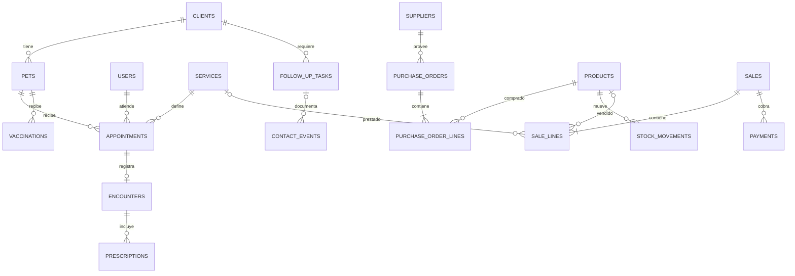

# Modelo inicial — una veterinaria, una sede, un almacén

La definición ejecutable está en [001_foundation.sql](../database/migrations/001_foundation.sql).
Hay 23 tablas del dominio, una vista de existencias y la tabla técnica
`schema_migrations`, creada por el ejecutor de migraciones.

| Área                       | Tablas                                                                                   |
| -------------------------- | ---------------------------------------------------------------------------------------- |
| Negocio y acceso           | `business_settings`, `users`, `user_sessions`, `password_reset_tokens`                   |
| Clientes y pacientes       | `clients`, `pets`                                                                        |
| Agenda y atención          | `services`, `appointments`, `encounters`, `prescriptions`, `vaccinations`                |
| Seguimiento                | `follow_up_tasks`, `contact_events`                                                      |
| Catálogo y compras         | `suppliers`, `product_categories`, `products`, `purchase_orders`, `purchase_order_lines` |
| Ventas y cobros            | `sales`, `sale_lines`, `payments`                                                        |
| Existencias y trazabilidad | `stock_movements`, `audit_logs`                                                          |

El diagrama muestra relaciones previstas: las cabeceras en borrador pueden
existir sin líneas. La obligatoriedad al confirmar se implementará en sus flujos.

## Decisiones e invariantes ya ejecutables

- Un solo registro de configuración del negocio; moneda PEN y zona America/Lima.
- UUID como identificadores; emails de usuario únicos sin distinguir mayúsculas.
- No se guardan contraseñas en claro ni tokens de sesión en claro. El bloque 3
  implementa generación, caducidad, revocación y autorización.
- Una mascota pertenece a un cliente. El cliente de una cita se deriva de la
  mascota, evitando duplicar propietario en la cita. Transferencias de propietario
  e historial de esas transferencias quedan fuera del primer alcance.
- Seguimientos y contactos con claves compuestas impiden asociar una mascota o
  tarea con otro cliente por error.
- Citas con inicio y fin válidos. Restricciones de exclusión de PostgreSQL evitan
  cruces de profesional y de mascota, incluso ante peticiones concurrentes.
  Intervalos `[inicio,fin)` permiten citas consecutivas. Canceladas y no asistidas
  no bloquean el horario. No es una agenda pública para dueños de mascotas.
- Solo profesionales con rol veterinario y activos pueden ser asignados al
  registrar/modificar una asignación clínica. Las rutas del bloque 3 comprueban el rol de quien accede; esta validación no sustituye autenticación.
- Una atención por cita. La consulta de antecedentes se deriva de la relación
  mascota → cita → atención, sin mantener una segunda historia duplicada.
- Cantidades e importes con `numeric`, sin usar flotantes para dinero. Líneas
  monetarias calculadas y redondeadas a dos decimales por PostgreSQL.
- Una línea de venta representa un producto o un servicio, nunca ambos.
- `product_stock` calcula saldo desde `stock_movements`. Un bloqueo por producto
  serializa salidas concurrentes y un trigger rechaza saldos negativos.
- Cada línea de compra/venta admite un solo movimiento vinculado. Libro de stock
  y auditoría son inmutables: se corrigen con asientos de compensación, no edición.
- No se eliminan clientes, pacientes ni documentos referenciados. Hay indicadores
  de actividad y estados para los futuros flujos de archivo/cancelación.

## Límites explícitos del bloque 2

El esquema define las entidades y restricciones fundamentales. Los procedimientos
transaccionales de recibir compras, confirmar ventas, conciliar el total de pagos,
cerrar una atención y generar auditoría automática se implementan junto a los
bloques 5, 7, 8 y 9. No se debe usar SQL directo como aplicación operativa: el modelo
todavía permite estados de borrador y no implementa todas las transiciones del negocio.
No se publican endpoints de escritura en esta entrega.

No incluye facturación electrónica SUNAT, pasarela bancaria, reserva pública,
recordatorios enviados automáticamente, varias sedes ni separación de múltiples
negocios. Antes de alojar varias veterinarias habrá que diseñar aislamiento de
datos, autorización y migraciones específicas. Las tablas de vacunas y recetas
no contienen recomendaciones clínicas predefinidas.

## Ampliación del bloque 3

`002_authentication.sql` añade `auth_rate_limits` e índices de caducidad a las
tablas de sesión y recuperación. El dominio del bloque 2 no se modifica.
Las contraseñas usan scrypt; los tokens de sesión y recuperación se guardan
como SHA-256 de un secreto aleatorio. Las reglas y operaciones de mantenimiento
se documentan en [AUTENTICACION.md](AUTENTICACION.md).

## Ampliación del bloque 4

`003_clients_pets.sql` añade `version` y `updated_at` a clientes y mascotas.
La API exige la versión leída para actualizar: incrementa el contador y audita
el cambio en una misma transacción. Un conflicto devuelve 409, sin sobrescribir
la ficha. Las claves únicas de documento y microchip existentes resuelven
duplicados, incluso concurrentes. Los estados activos permiten archivo reversible
sin eliminar relaciones ni historial. No se transfieren mascotas entre responsables.
Detalles, contrato y validaciones en [CLIENTES-Y-MASCOTAS.md](CLIENTES-Y-MASCOTAS.md).
